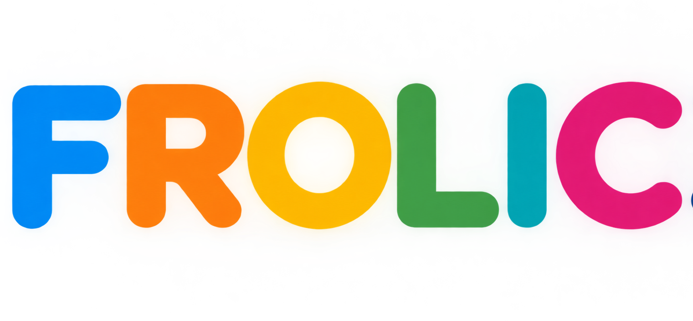

<p align="center">
  
</p>

<p align="center">
  <strong>Full-body Reconstruction Of Little Ones and Interacting Caregivers</strong>
</p>

<p align="center">
  A multi-view, multi-person, child-aware 3D human mesh pipeline.
</p>


## What it does

```
synced videos
  -> 2D pose per camera for everyone (YOLOX + RTMPose, Halpe-26)
  -> cross-view association + triangulation + identity tracking (appearance re-ID + geometry)
  -> track refinement, floor detection and levelling (metric room frame, floor z = 0)
  -> single-view fallback (people seen by one camera lifted via floor / stature priors)
  -> SAM 3D Body per camera on every person's box -> multi-view MHR fit
  -> Anny body fit: shape from the tracks (children get child bodies), pose from SAM 3D Body (dense, gated),
     biomechanical constraints (joint limits incl. paediatric ranges, capsule self-collision, foot rules,
     angular-velocity limits), root-rotation continuity, single-view weighting and bridging
  -> export (mesh per person per frame; a person is hidden only when no camera sees them)
  -> render (overlay on the raw views, camera grid, 3D room view, trajectories)
```

Any number of cameras (>= 2), any number of people, any frame rate and resolution. People get stable ids
(`p0`, `p1`, ...); no roles are baked in. Optional labels and attributes (age, height, sex, weight) per person fix the
body phenotype when known.

## Install

```bash
git clone <this repository> && cd FROLIC3D
conda env create -f environment.yml && conda activate frolic3d      # everything, CUDA builds of torch / onnxruntime
# or a minimal install plus the extras you need:
pip install -e ".[detect,track,anny,render,sync,dev]"
```

`ffmpeg` and `ffprobe` must be on `PATH`. Rendering needs an offscreen OpenGL (EGL on a GPU node, or OSMesa).

### Models (not included)

| model | how to get it | config |
|---|---|---|
| YOLOX tiny + RTMPose-x halpe26 (ONNX) | downloaded automatically by `rtmlib` from the OpenMMLab release on first use (`https://download.openmmlab.com/mmpose/v1/projects/rtmposev1/onnx_sdk/`); set `RTMLIB_CACHE` or let it use `~/.cache/rtmlib` | `detect.det_model`, `detect.pose_model` |
| OSNet re-ID weights | torchreid model zoo, `osnet_ain_x1_0` trained on MSMT17 (`https://kaiyangzhou.github.io/deep-person-reid/MODEL_ZOO`); download the `.pth` | `track.reid_weights` |
| SAM 3D Body | clone `https://github.com/facebookresearch/sam-3d-body`, request the checkpoint from Meta and place it under `checkpoints/sam-3d-body-dinov3/` (model.ckpt, assets/mhr_model.pt) | `sam3d.root` or `FROLIC_SAM3D_ROOT` |
| Anny | `pip install anny` (NAVER); the body assets are fetched into a cache directory on first use | `fit.anny_cache` or `ANNY_CACHE_DIR` |

Licences and the restrictions that apply to redistribution and commercial use are listed in `THIRD_PARTY.md`.

## Quick start (synthetic example, no models needed)

```bash
python examples/synthetic/make_scene.py            # four cameras, two stick-figure people, 90 frames
frolic run -c examples/synthetic/frolic.yaml        # every stage with mocked detector / SAM 3D Body / Anny
frolic status -c examples/synthetic/frolic.yaml
ls examples/synthetic/data/work/export              # p0.npz p1.npz meta.json metrics.json summary.csv
```

On real data:

```bash
frolic init my_session/frolic.yaml                  # commented template with every option
# edit: input.video_dir, calib.mode, people labels, ...
frolic run -c my_session/frolic.yaml                # or one stage at a time: frolic detect -c ...
```

## Stages

`sync -> detect -> calibrate -> track -> select -> singleview -> sam3d -> fit -> export -> render`

| stage | command | input | output |
|---|---|---|---|
| sync | `frolic sync` | videos (synced or not) | `work/videos.json` with per-camera offsets; trimmed, aligned copies when `sync.trim` |
| detect | `frolic detect` | aligned videos | `work/detect/<camera>.npz` boxes, Halpe-26 keypoints, scores, torso colour |
| calibrate | `frolic calibrate` | board videos, or the detections (bootstrap), or a file | `work/calib/cameras.json` |
| track | `frolic track` | detections + cameras | `work/track/tracks.npz` (identities), `work/track/cameras.json` (floor-levelled) |
| select | `frolic select` | tracks | `work/select/tracks.npz`, `selection.json`, contact sheet |
| singleview | `frolic singleview` | selected tracks + detections | `work/singleview/tracks.npz`, `svfill.json` |
| sam3d | `frolic sam3d` | tracks + videos | `work/sam3d/mhr/<id>.npz`, `<id>_verts.npy` |
| fit | `frolic fit` | tracks + sam3d | `work/fit/<id>.npz`, `<id>_verts.npy`, `faces.npy` |
| export | `frolic export` | fit | `work/export/<id>.npz`, `meta.json`, `cameras.json`, `metrics.json`, `summary.csv` |
| render | `frolic render` | export + videos | `work/render/*.mp4` |

Every stage is idempotent: a done marker in `work/done/` makes `frolic run` skip it. `frolic <stage> --force` redoes
that stage and clears every later marker; `frolic run --from fit --force` restarts from `fit`; `frolic run --to track`
stops after `track`. `frolic status` lists the markers. Logs go to `work/logs/<stage>.log`.

`--device cuda|cuda:0|cpu` and `--threads N` apply to every command. Stages that must run in a different Python
environment (for example SAM 3D Body in its own env) are declared in `compute.stage_python: {sam3d: /path/to/python}`;
`frolic run` then executes that stage as a subprocess in that interpreter.

## Configuration

One YAML file validated against `frolic3d/config.py`; unknown keys are errors. `frolic init` writes the template with
every default and a comment per option; `docs/config.md` is the reference generated from the model.

```yaml
input:   {video_dir: videos, work_dir: work, synced: false}
sync:    {trim: true}
calib:   {mode: board, board: {video_dir: board_videos, square_length: 0.095, marker_length: 0.071}}
detect:  {masks: {cam2: [[[0, 0], [400, 0], [400, 300], [0, 300]]]}}   # a mirror in cam2
track:   {fps: 15, merge: [[p1, p3]]}
select:  {mode: auto, min_views: 2, min_track_s: 2.0, labels: {p0: adult, p2: child}}
people:  {p2: {age_years: 3.5, height_m: 0.98, sex: female}}
fit:     {biomech: {enabled: true}}
render:  {what: [overlay, grid, room, trajectories], fps: 30, crf: 18}
```

## Person selection

Tracking reconstructs everyone; `select` decides who goes on to the body fit.

- `select.mode: auto` (default): keep identities seen by at least `min_views` cameras somewhere, tracked for at
  least `min_track_s`, within optional height bounds, `children_only` (stature below `child_height_m`), at most
  `max_people`. Labels come from `select.labels` or `people.<id>.label`.
- `select.mode: interactive`: the stage writes a numbered contact sheet (`work/select/sheet.jpg` + `sheet.html`, one row
  per identity with crops from each camera) and asks for ids. `select.picker: cli` reads them from the terminal,
  `opencv` / `matplotlib` open a small picker, `file` reads `select.selection_file` (one id per line) so that a headless
  job can be answered from another machine.
- `select.mode: config`: `select.ids` lists the identities to keep.

Identity assembly can be corrected before selection with `track.merge` (same person split in two ids),
`track.split` (two people merged, split at given times) and `track.drop` (ghosts). `select.spans_min_views: k`
restricts reconstruction to spans where a person is seen by at least `k` cameras.

## Calibration

- `calib.mode: board`: ChArUco board videos in `calib.board.video_dir`, one per camera with the same names as the
  input videos. Per camera: intrinsics from a pose-diverse frame subset with sanity checks (fx/fy ratio, principal
  point, implausible parameters flagged even when the RMS is low; optional `fix_aspect_ratio`, `fix_k3`); then board
  poses (IPPE), chained extrinsics and a multi-frame bundle adjustment across all cameras; metric scale from
  `square_length`; floor levelling afterwards from the people. The board model and the JSON files follow the
  [ChArUco calibrator GUI](https://github.com/nairg1/charuco-calibrator-gui): its intrinsics JSON can be reused
  (`calib.board.intrinsics_json`) and FROLIC writes a `multi_camera_extrinsics.json` the GUI's visualizer opens.
  FROLIC's implementation is independent code whose design follows that tool (OpenCV >= 4.7 ArUco object API,
  intrinsics safeguards, constrained re-solve of degenerate views, multi-frame extrinsics); it adds video input,
  pose-diverse sampling and a bundle adjustment across all cameras and frames.
- `calib.mode: bootstrap`: no board. Camera poses and focal lengths come from the 2D keypoints of frames where one
  person is seen by every camera (incremental structure from motion + bundle adjustment; a shared focal length is
  searched over `calib.bootstrap.fov_range_deg` unless `focal_guess` is set). Those frames are grouped by clothing
  colour; `calib.reference_height_m` is the stature of the group chosen by `calib.bootstrap.person` (`most_seen`,
  `tallest` or `shortest`) and sets the metric scale.
- `calib.mode: given`: `calib.given` in FROLIC's `cameras.json` schema, or converted with `calib.given_format`
  (`gui` = calibrator-GUI multi-camera JSON, `anipose` = TOML, `opencv` = YAML with K/dist/R/t per camera).

`calib.level_floor` (default on) rotates the world so that the standing feet lie on z = 0, and shifts the cameras with it.

## Single-view fallback

A tracked person who drops to fewer than two triangulating cameras would otherwise vanish. `singleview` finds the
confident detections that belong to them (geometry gate on the pelvis ray, torso colour and re-ID margins, not claimed by
another person), lifts them along the ray with a depth fused from the track prior, the pelvis-height plane, limb
lengths, feet on the floor and a second camera when one agrees, takes joint depths from SAM 3D Body when available, then
smooths and rejects (room bounds, speed, height, limb sanity). The fit uses those frames at `fit.sv_weight` and bridges
holes next to them up to `fit.sv_bridge_s`. The export then hides a person only on frames no camera observes.

## Rendering

`frolic render --what overlay|grid|room|trajectories` (or `render.what` in the config):

- `overlay`: one video per camera; meshes are rendered with the pinhole model and warped into the raw frame through the
  lens distortion, so the video itself is untouched.
- `grid`: all cameras tiled.
- `room`: 3D view with a floor grid, camera frustums, contact shadows and a slow eased pan; legend with one colour per
  person; no titles.
- `trajectories`: room view with fading pelvis trails.

`render.fps`, `render.crf`, `render.tile_width`, `render.room_width/height`, `render.colours`, `render.start_s`,
`render.duration_s` control the output. When `render.fps` exceeds the track rate the meshes are interpolated (Catmull-Rom)
and the video frames are taken at the nearest source frame.

## Outputs

`work/export/<id>.npz` holds `vertices (N, V, 3)` float16 (NaN when hidden), `faces`, `joints (N, 17, 3)`,
`joint_names`, `frame_times`, `source_frames`, `phenotype`, `stature_m`, `single_view`, `observed`, `label`;
`meta.json`, `cameras.json`, `metrics.json` (coverage, box IoU and 2D error against the detector, jitter, flips, root
spins, floor contact, biomechanical violations) and `summary.csv`. Full schema: `docs/output_schema.md`.

## HPC / Slurm

```bash
frolic run -c frolic.yaml --slurm --dry-run     # writes work/slurm/<stage>.sbatch
frolic run -c frolic.yaml --slurm               # submits one job per pending stage, chained with afterok
```

Partitions, GPU resource string, CPUs, memory, time limits, account and setup lines (`module load`, `conda activate`)
come from `compute.slurm`. GPU stages (`detect`, `track`, `sam3d`, `fit`, `render`) go to `partition_gpu`, the rest to
`partition_cpu`. Nothing site-specific is built in.

## Troubleshooting

| symptom | cause / fix |
|---|---|
| `no offscreen OpenGL backend` | install `frolic3d[render]`; on a GPU node use EGL (`PYOPENGL_PLATFORM=egl`, PyOpenGL 3.1.0 is the version pyrender 0.1.45 works with); on CPU nodes install OSMesa and set `render.backend: osmesa` |
| `calib.mode = bootstrap needs calib.reference_height_m` | the calibration-free mode needs one known stature for metric scale |
| sync fails or closure above `max_closure_ms` | audio too quiet or clocks drifting; set `sync.manual_offsets_s` or trim the videos yourself and set `input.synced: true` |
| detector finds a poster / mirror reflection | add a polygon to `detect.masks` for that camera; static detections are also suppressed automatically (`detect.static_occupancy`) |
| two ids for one person / one id for two people | `track.merge` / `track.split`, then `frolic track --force` |
| ChArUco intrinsics reported as implausible | the board was seen from too few angles in that camera; record more tilted views or reuse intrinsics from another session (`calib.board.intrinsics_json`) |
| `frolic run` skips a stage you changed | markers: `frolic <stage> --force` or `frolic run --from <stage> --force` |
| SAM 3D Body / Anny import errors | set `sam3d.root` / `fit.anny_cache` (or the environment variables) or run those stages in their own interpreter via `compute.stage_python` |

## Development

`make test`, `make cov`, `make lint`; see `CONTRIBUTING.md`, `docs/architecture.md` and `docs/CONTRACTS.md`.
The unit and end-to-end tests mock every heavy model. `make test-gpu` runs the real models on a local clip:
`FROLIC_TEST_CLIP=/path/to/clip_folder` (one video per camera), plus `FROLIC_TEST_CALIB=cameras.json` or
`FROLIC_TEST_HEIGHT=<m>` for the calibration-free bootstrap. Keep the clip outside the repository.

## Citation

```
@misc{frolic3d,
  title  = {FROLIC 3D: Full-body Reconstruction Of Little ones and Interacting Caregivers},
  author = {<authors>},
  year   = {<year>},
  url    = {<repository url>}
}
```

Please also cite the models you use: SAM 3D Body (Meta), Anny (NAVER), RTMPose / MMPose, YOLOX, OSNet (torchreid),
aniposelib. See `THIRD_PARTY.md`.

## Licence

Not decided yet; `LICENSE` is a placeholder. `THIRD_PARTY.md` discusses the options against the model licences.
